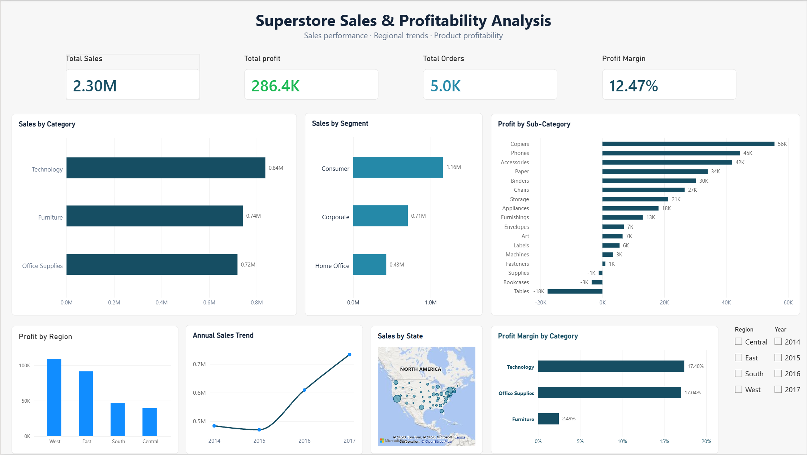

# Superstore Sales & Profitability Analysis

## Overview
This project analyzes retail sales, profitability, product performance, customer segments, and regional trends using SQL and Power BI. The objective is to identify business insights related to revenue, profit margins, product categories, and geographic performance.

## Dashboard Preview

## Key Metrics
- Total Sales
- Total Profit
- Total Orders
- Profit Margin

## Analysis
- Sales by Category
- Sales by Segment
- Profit by Sub-Category
- Profit by Region
- Annual Sales Trends
- Sales Performance by State
- Profit Margin by Category

## Tools Used
- **SQL** — Data querying and business analysis
- **Power BI** — Dashboard development and visualization
- **Excel / CSV** — Data preparation and handling

## Key Objectives
- Evaluate overall sales and profitability
- Identify high-performing and underperforming product categories
- Compare sales across customer segments
- Analyze regional performance
- Track annual sales trends
- Examine profit margins across categories and sub-categories

## Files
- `Dashboard/` — Power BI dashboard (.pbix)
- `Screenshots/` — Dashboard preview image
- `SQL/` — SQL queries used for analysis
- `Data/` — Dataset files, if included

## Dataset
Sample Superstore retail dataset containing order information, sales, profits, product categories, customer segments, locations, and dates.